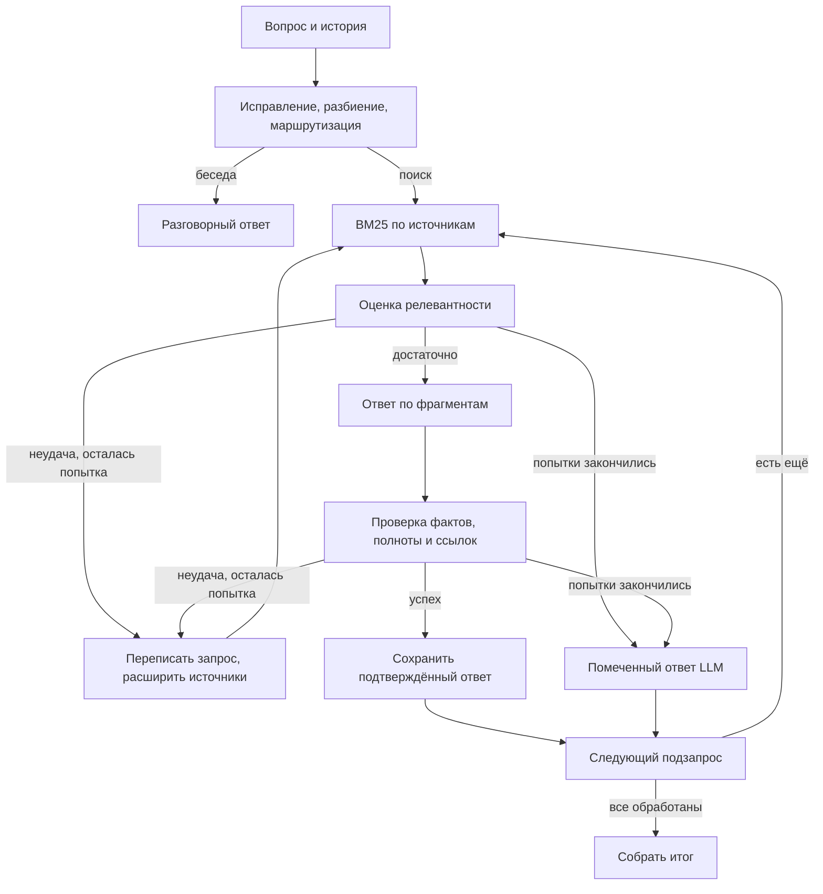

# Линза — RAG Lab

Учебный проект для задания 4 Light из лекции «Экономика LLM». Python + LangGraph + Streamlit + Groq. Поиск — локальный SQLite FTS5 / BM25, без платных эмбеддингов и внешней базы данных.

## Быстрый запуск на Windows

Нужен Python 3.11 или новее. Откройте PowerShell в этой папке.

```powershell
powershell -ExecutionPolicy Bypass -File .\setup.ps1
notepad .env
```

В `.env` заполните только свою строку:

```dotenv
GROQ_API_KEY=ваш_ключ
```

Ключ создаётся в [Groq Console](https://console.groq.com/keys). Не отправляйте `.env` вместе с проектом. Приложение не отображает и не пишет ключ в журнал.

```powershell
powershell -ExecutionPolicy Bypass -File .\start.ps1
```

Откройте http://localhost:8501. На этом компьютере подготовленная база находится в `data/rag.db`. В архив исходников база не входит.

Если базы нет, проиндексируйте **уже скачанные** файлы (скрипт не скачивает ничего):

```powershell
.\.venv\Scripts\python.exe index_local.py
```

По умолчанию ищет в пользовательской папке Downloads:

- `10_000-постов-Хабр.csv.bz2`
- `10_000-постов-Лента.csv.bz2`
- `10_000-статей-arxiv2.tar.gz`

Для другой папки: `python index_local.py --directory "D:\Datasets"`. Архивы распаковывать не нужно. Исходники не изменяются. Повторная индексация пропускает дубликаты. Для большой базы оставьте несколько гигабайт свободного места. Скрипт показывает прогресс каждые 100 документов.

## Что реализовано

| Пункт задания | Реализация |
|---|---|
| Загрузка трёх источников | Потоковое чтение сжатых CSV; соединение JSON-метаданных arXiv с TXT по идентификатору; дополнительные TXT, MD, HTML, JSONL, JSON, PDF с текстовым слоем, DOCX, ZIP |
| Беседа / поиск | Узел `plan`, условная ветка `chat` |
| Исправление опечаток | `plan.corrected`; исходный и исправленный запрос видны в трассировке |
| Составной вопрос | До трёх самостоятельных подзапросов; отдельные ответы и источники |
| Маршрутизация | Отдельный набор источников у каждого подзапроса |
| Нет ответа | Явно помеченный ответ из общих знаний LLM; это разрешённая заданием альтернатива веб-поиску |
| Самопроверка / коррекция | Оценка найденного → генерация → независимая проверка → переписывание запроса и повторный поиск; максимум две попытки на подзапрос |
| Промежуточные результаты | Поток событий LangGraph, JSON каждого этапа и скачивание трассировки |
| Cost Dashboard | Входные/выходные токены, время, оценка USD по вызову, этапу, запросу и серии; индексация, повторы и ошибки учитываются |
| Модели разного размера | По умолчанию `openai/gpt-oss-20b` для служебных шагов и `openai/gpt-oss-120b` для ответа через Groq |
| Контрольные вопросы | `control_questions.json`, 12 сценариев с ожидаемым поведением |

Названия моделей меняются у провайдера. При ошибке доступности укажите действующие идентификаторы в `SMALL_MODEL` и `LARGE_MODEL`. Документация: [Groq: изменения моделей](https://console.groq.com/docs/deprecations), [лимиты](https://console.groq.com/docs/rate-limits).

## Экономика

Индексация и поиск не вызывают LLM. Начальный анализ объединяет исправление, разбиение и маршрутизацию в один вызов небольшой модели. На один обычный поисковый вопрос приходится обычно четыре вызова: анализ, отбор, ответ, проверка. Составные вопросы и повторы расходуют больше лимита.

В `.env.example` тарифы равны нулю: это оценка для использования бесплатного доступа Groq, не обещание неограниченной бесплатной работы и не сведения о биллинге аккаунта. Точные лимиты смотрите в своей консоли Groq. При HTTP 429 выполняется максимум один короткий повтор; затем приложение предлагает подождать.

Чтобы сравнивать условную стоимость моделей, задайте цену за миллион входных/выходных токенов в `SMALL_INPUT_PRICE`, `SMALL_OUTPUT_PRICE`, `LARGE_INPUT_PRICE`, `LARGE_OUTPUT_PRICE`. Формула: `(input_tokens × input_price + output_tokens × output_price) / 1_000_000`. Это не включает электричество, оборудование и возможные особые правила биллинга. Для отсутствующего usage или сетевой ошибки расход отмечается как неизвестный в столбце status.

## Архитектура



Фрагменты: до 1800 символов с перекрытием 250. Из поиска берутся шесть кандидатов, не более двух от одного документа; после отбора — не более четырёх. Ссылки имеют локальную нумерацию внутри каждого ответа на подзапрос. Финальная сборка выполняется без LLM, чтобы не искажать проверенные ответы.

`rag/store.py` — индекс и журнал расходов; `rag/loaders.py` — форматы данных; `rag/llm.py` — Groq и usage; `rag/graph.py` — граф; `app.py` — интерфейс. Документация графа: [LangGraph StateGraph](https://reference.langchain.com/python/langgraph/graph/state/StateGraph/add_conditional_edges). Интерфейс этапов использует [Streamlit status](https://docs.streamlit.io/develop/api-reference/status).

## Проверка и защита проекта

```powershell
.\.venv\Scripts\python.exe -m pytest tests -q
```

Тесты используют подставную модель, поэтому не тратят лимит и проверяют логику: разговорную ветку, составные вопросы, возврат к поиску, ограничение попыток, fallback, недопустимые ссылки, дедупликацию, фильтрацию источников, суммирование расходов и форматы корпусов. Они не заменяют оценку реальных ответов Groq.

После добавления ключа пройдите вопросы из `control_questions.json`. Для каждого запишите: корректный маршрут, исправленные опечатки, покрытие частей вопроса, качество ссылок, наличие неподтверждённых утверждений, токены и время. Вопросы для Хабра, Ленты и arXiv опираются на найденные в наборах записи. Не все произвольные темы обязательно есть в корпусах.

## Ограничения

- Retrieval лексический (BM25), не семантические эмбеддинги. Синонимы и перевод запроса добавляет LLM. Это осознанный выбор для бесплатного запуска без скачивания моделей.
- Самопроверка тоже выполняется LLM и может ошибаться. Сопоставление ссылок дополнительно проверяется кодом.
- Веб-поиск не реализован: при нехватке информации используется разрешённый заданием ответ LLM с предупреждением.
- Новости и научные тексты исторические. Для актуальных фактов нужна внешняя проверка.
- PDF без текстового слоя требует OCR, которого в этой версии нет.
- Приложение рассчитано на локальное использование одним пользователем. История диалога — в сессии браузера, индекс и расходы — на диске.
- Без пользовательского ключа невозможно проверить настоящий вызов Groq; до его добавления доступны библиотека и Cost Dashboard.
